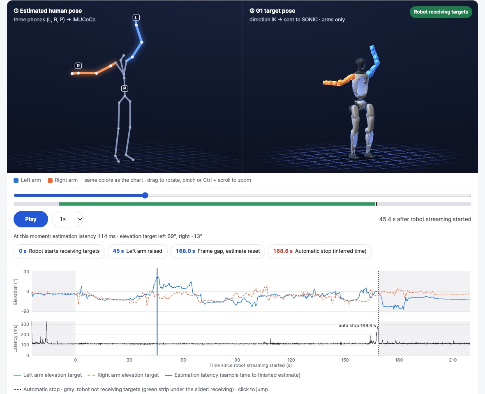
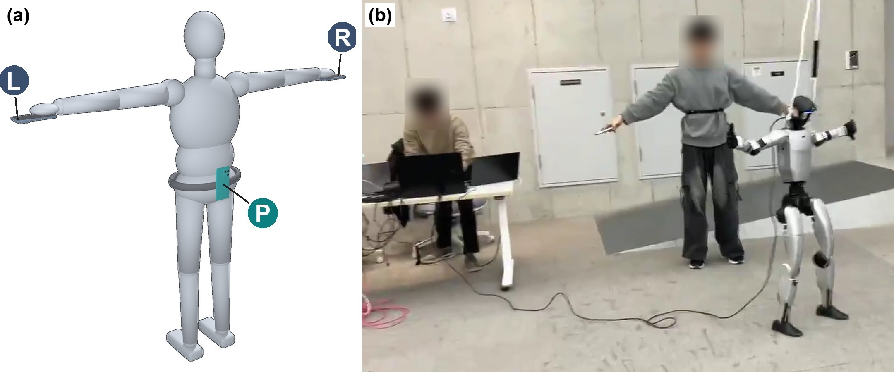
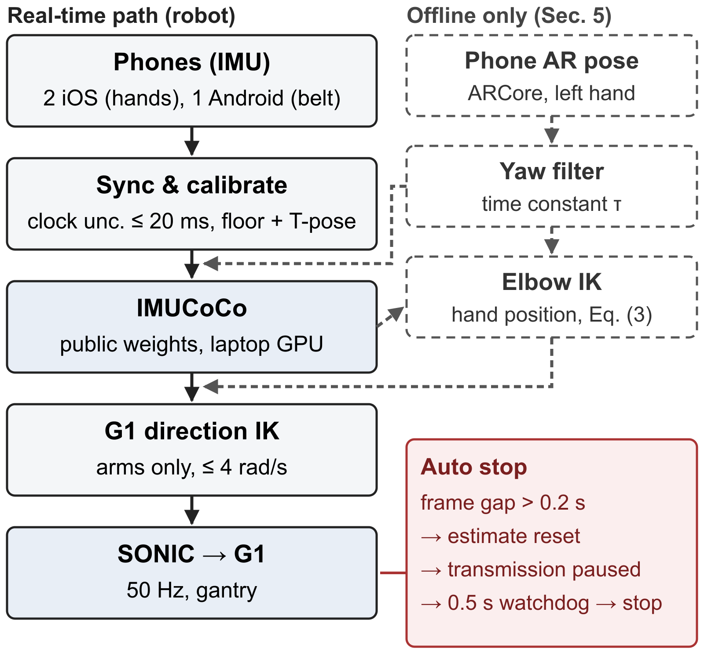
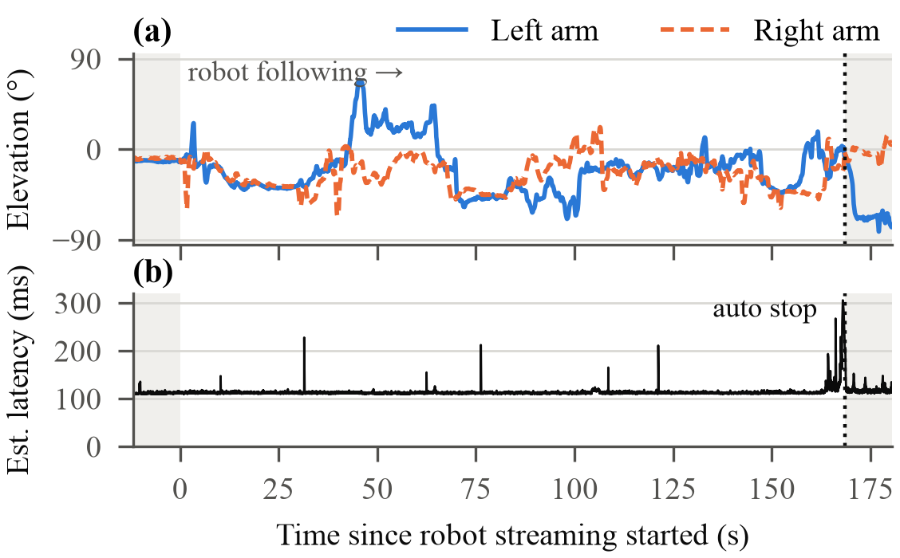

# 손에 든 스마트폰으로 G1 휴머노이드 상체 원격조작

[English](README.md) · **한국어**

KRoC 2027 투고 논문 「손에 든 스마트폰으로 G1 휴머노이드 상체 원격조작」(안상현·강재욱·박세환, 서울대학교)의 실험 기록, 그림, 웹 재생 페이지를 모은 저장소입니다. 양손에 하나씩, 허리 벨트에 하나 둔 스마트폰 3대만으로 실물 Unitree G1의 상체를 실시간으로 원격조작했습니다.

- **성격:** 로봇 실험, 학부생 팀 연구. 이 저장소는 논문의 공개 자료입니다.
- **담은 것:** 실물 시연 두 건의 기록(식별 정보만 가명 처리), 폰 3대 실행의 웹 재생, 논문 그림, 기록에서 논문 수치를 다시 계산하는 스크립트
- **기술:** 폰 IMU(iOS·Android), IMUCoCo 자세 추정, G1 29자유도 방향 IK, NVIDIA SONIC 전신 정책

**브라우저에서 보기: [sesepark.github.io/smartphone-g1-teleop](https://sesepark.github.io/smartphone-g1-teleop/)** · **논문: [PDF](paper/KRoC2027_handheld_smartphone_G1_teleoperation.pdf)**



*실물 G1에서 폰 3대로 한 마지막 실행(2026-11-22)의 웹 재생. 왼쪽은 폰 입력으로 추정한 사람 자세, 오른쪽은 SONIC에 보낸 G1 목표 자세, 아래는 팔 고도 목표와 추정 지연입니다. 점선은 자동 정지입니다. 두 자세 모두 추정 서버의 기록이며 로봇을 측정한 값은 아닙니다.*



*논문 Fig. 2. (a) 뒤에서 본 폰 배치: 양손의 iOS 폰 L·R, 허리 벨트의 Android 폰 P. (b) 갠트리에 매단 G1이 조작자를 따라 움직이는 장면. 얼굴은 흐리게 처리했습니다.*

## 프로젝트 개요

휴머노이드 원격조작에는 보통 VR 헤드셋이나 모션캡처 수트가 필요합니다. 이 연구는 누구나 가진 스마트폰으로 이를 대신할 수 있는지 확인했고, 기여는 세 가지입니다.

1. **폰 IMU에서 실물 G1까지 이어지는 실시간 파이프라인.** 폰의 회전과 가속도를 공개 모델 IMUCoCo와 방향 IK로 G1 목표 관절각으로 바꿔 NVIDIA SONIC 정책에 넣었고, 폰 3대로 갠트리에 매단 G1 상체를 원격조작했습니다.
2. **입력이 끊기면 로봇을 세우는 자동 정지와 실물 확인.** 입력이 끊기면 추정을 초기화하고 전송을 멈추며, 0.5 s watchdog이 로봇을 정지시킵니다.
3. **폰 AR 손 위치로 팔꿈치 정하기(사후 재생).** 손에 든 IMU만으로는 팔꿈치 위치가 정해지지 않습니다. AR이 추적한 손목 위치로 팔꿈치 굽힘을 정하는 해석적 swivel IK를 구현했고, 녹화한 한 팔 데이터를 재생해서만 평가했습니다.



*논문 Fig. 1. 실선은 실물 G1에 쓴 실시간 경로와 자동 정지, 점선은 사후 재생에서만 쓴 AR 결합입니다.*

## 구현 내용

| 단계 | 내용 | 실행 기록에 남은 설정 |
| --- | --- | --- |
| 폰 입력 | Android game rotation vector, iOS `xArbitraryZVertical` 자세(지자기 미사용), 폰마다 타임스탬프 4개로 시계 동기화 | 시계 추정 오차 20 ms 초과 샘플 제외, 60 Hz 리샘플링 |
| 캘리브레이션 | 바닥 정렬 8 s, 손바닥을 아래로 한 T자 8 s | `tpose_variant = palms_down` |
| 자세 추정 | 저자 공개 가중치의 IMUCoCo(재학습 없음), 장착 위치는 양손과 골반 뒤 | upstream 커밋 `d7dd17c` |
| 리타게팅 | 링크 방향을 맞추는 감쇠 최소제곱 IK, 양팔 관절만 갱신, 관절 속도 4 rad/s 제한 | `g1_target_scope = arms` |
| SONIC | 참조를 0.35 s 늦춰 50 Hz로 공식 컨트롤러에 전송(ZMQ), G1과는 유선 DDS | `delay_seconds = 0.35` |
| 정지 | 정렬한 프레임 간격이 0.2 s를 넘으면 추정 초기화와 전송 중단, 전송 없이 0.5 s가 지나면 watchdog 정지 | `max_gap_seconds = 0.2`, `watchdog_timeout_seconds = 0.5` |

폰 수신부터 SONIC 컨트롤러까지 GPU 노트북 한 대에서 실행했습니다. 오른쪽 열의 값은 공개한 `session.json`, `sonic-live.json`, 컨트롤러 파일에서 읽은 것이며 `tools/check_paper_numbers.py`가 하나씩 확인합니다.

## 결과

**실물 시연(갠트리에 매단 G1)**

| 시연 | 폰 | 결과 | 기록 |
| --- | --- | --- | --- |
| 1차, 2026-11-21 | 오른손 iOS 폰 1대 | G1 오른팔이 조작자를 따라 움직임을 세 차례 확인. 폰 앱을 닫자 마지막 입력 **0.976 s** 뒤에 자동 정지 | [`data/runs/20261121-215716-g1-supported-one-iphone`](data/runs/20261121-215716-g1-supported-one-iphone) |
| 2차, 2026-11-22 | 양손 iOS 폰 2대 + 허리 벨트 Android 폰 1대 | 7회 실행, 양팔 추종을 영상으로 확인. 마지막 실행은 약 2분 50초 이어졌고, 노트북 웹 창을 닫은 상태의 2분 38초 시점 10 s 구간에서 **60.0 frames/s**, 추정 지연 p95 **114 ms**. 프레임 간격이 0.2 s를 넘자 watchdog이 로봇을 정지시키며 끝남 | [`data/runs/20261122-174632-live-three-phone-dev`](data/runs/20261122-174632-live-three-phone-dev) |

60.0 frames/s와 114 ms는 실행 중 Studio 화면에 나온 값입니다. 같은 기록으로 로봇 구간을 10 s씩 나눠 사후에 다시 계산하면 16개 구간에서 58.7–60.0 frames/s, 추정 지연 p95 113.4–118.3 ms입니다. 추정 지연은 입력 샘플 시각부터 추정 완료까지이며 SONIC의 참조 지연 0.35 s는 포함하지 않습니다.



*논문 Fig. 3. (a) G1 팔 고도 목표, (b) 추정 지연. 점선은 자동 정지, 회색은 로봇이 추종하지 않은 구간입니다. `tools/fig3_run7_timeline.py`가 공개 기록으로 다시 그리며, 2026-11-25 기준 논문 그림과 바이트 단위로 같았습니다.*

**AR 팔꿈치, 사후 재생(예비 결과).** Android 폰 1대를 왼손에 쥐고 녹화한 한 팔 개발 데이터 3건을 같은 코드로 재생해 AR 손 위치 유무를 비교했습니다.

| 녹화 | 조건 | 고도각 오차 (°) | jerk p95 팔꿈치 / 손목 (m/s³) |
| --- | --- | ---: | ---: |
| 1 | IMU-only | 25.85 | 517.7 / 903.1 |
| 1 | AR yaw | 25.88 | 520.8 / 905.6 |
| 1 | AR IK | 17.63 | 1617.9 / 3015.9 |
| 2 | IMU-only | 53.05 | 208.7 / 328.6 |
| 2 | AR IK | 56.01 | 255.3 / 431.5 |
| 2 (recomp.) | AR IK | 22.88 | 537.8 / 742.9 |
| 3 | IMU-only | 43.23 | 610.4 / 1028.5 |
| 3 | AR IK | 12.55 | 936.7 / 1461.8 |

팔 고도각 오차는 녹화 1과 3에서 줄었습니다. 녹화 2는 기록된 AR 입력으로는 오히려 늘었고, 같은 타임스탬프에서 AR 입력을 다시 계산하면 줄었습니다. 손목 jerk p95는 1.3–3.3배 늘어 폰 3대 비교용으로 미리 정한 10% 한도를 넘었습니다. 원본: [`data/one-arm-replay/metrics.csv`](data/one-arm-replay/metrics.csv).

## 시작하기

**실행 재생 보기.** [웹 재생](https://sesepark.github.io/smartphone-g1-teleop/)을 엽니다. WebGL을 지원하는 데스크톱·모바일 브라우저에서 동작합니다. 로컬에서 띄우려면:

```sh
git clone https://github.com/sesepark/smartphone-g1-teleop
cd smartphone-g1-teleop
python3 -m http.server 8000 --directory docs   # http://127.0.0.1:8000 접속
```

**논문 수치 다시 계산.** Python 3 표준 라이브러리만 쓰고 10초쯤 걸립니다.

```sh
python3 tools/check_paper_numbers.py          # 검사 35개, 하나라도 틀리면 0이 아닌 값으로 종료
```

**파생 파일 다시 만들기.**

```sh
python3 tools/build_web_replay.py data/runs/20261122-174632-live-three-phone-dev docs/data
uv run --no-project --with numpy --with matplotlib python tools/fig3_run7_timeline.py   # numpy·matplotlib이 있는 Python이면 됨
```

`tools/prepare_public_data.py`는 팀의 원본 기록 묶음에서 공개 기록을 만든 방법을 남긴 스크립트입니다. 원본이 있어야 돌아가므로 다른 사람이 다시 실행할 용도는 아닙니다.

## 문서

| 문서 | 내용 |
| --- | --- |
| [paper/](paper/README.md) | 투고 원고(PDF, 한국어 본문·영문 초록) |
| [EVIDENCE.md](EVIDENCE.md) | 논문의 수치·설정과 그 근거 파일, 검사 항목 |
| [data/README.md](data/README.md) | 파일 형식, 11/22 실행 목록, 가명 처리한 항목 |
| [data/one-arm-replay/README.md](data/one-arm-replay/README.md) | Table 1의 조건과 열 설명 |
| [THIRD_PARTY.md](THIRD_PARTY.md) | G1 메시, IMUCoCo, SONIC과 각 라이선스 |

## 사용 범위와 한계

- 실물 실행은 IMU 경로만 썼습니다. AR 팔꿈치 방법은 한 사람이 녹화한 개발 데이터 3건으로 사후 평가만 했고 로봇에서는 돌리지 않았습니다. 실물 실행 중 폰의 AR 자세는 수신해 기록만 했습니다.
- 로봇의 추종 정확도는 재지 않았습니다. 사람 자세의 참값이 없고, 재생 화면은 추정 자세와 목표 관절각이지 로봇 관절 측정값이 아닙니다.
- 정지하면 로봇의 힘이 풀리므로 갠트리가 필요합니다. 입력 공백은 무선 수신과 노트북 처리 양쪽에서 생겼습니다.
- 넣지 않은 것: 얼굴이 나온 영상, Table 1의 원본 한 팔 녹화 3건, 3.1절 38.9°의 지자기 기록, τ = 4.66 s의 정지 기록, 시스템 코드(폰 앱, 추정 서버, SONIC 연결부). 시스템 코드는 팀의 비공개 저장소에 있습니다.
- 폰 식별자, 내부 IP, 노트북 경로만 가명으로 바꿨고 측정값과 타임스탬프는 그대로입니다.

## 관련 프로젝트

- [IMUCoCo](https://github.com/cmusmashlab/IMUCoCo): 임의 위치 IMU로 자세를 추정하는 모델. 공개 가중치를 그대로 썼습니다.
- [GR00T Whole-Body Control (SONIC)](https://github.com/NVlabs/GR00T-WholeBodyControl): 실물 G1에 쓴 전신 추종 정책과 컨트롤러.
- [unitree_mujoco](https://github.com/unitreerobotics/unitree_mujoco): G1 모델과 웹 재생에 쓴 메시의 원본.

## 인용

```bibtex
@inproceedings{an2027smartphone,
  title     = {Hand-Held Smartphone Teleoperation of a {G1} Humanoid Upper Body},
  author    = {An, Sanghyun and Kang, Jae Wook and Park, Sehwan},
  booktitle = {Korea Robotics Society Annual Conference (KRoC)},
  year      = {2027},
  note      = {Submitted}
}
```

## 라이선스

코드는 GPL-3.0([LICENSE](LICENSE)), `data/`와 `docs/data/`의 실험 기록은 CC BY 4.0입니다. 논문과 그림은 저자에게 저작권이 있으며 재사용을 허락하지 않습니다. G1 메시는 Unitree의 BSD-3-Clause를 따릅니다. 자세한 내용은 [data/LICENSE.md](data/LICENSE.md)에 있습니다.
