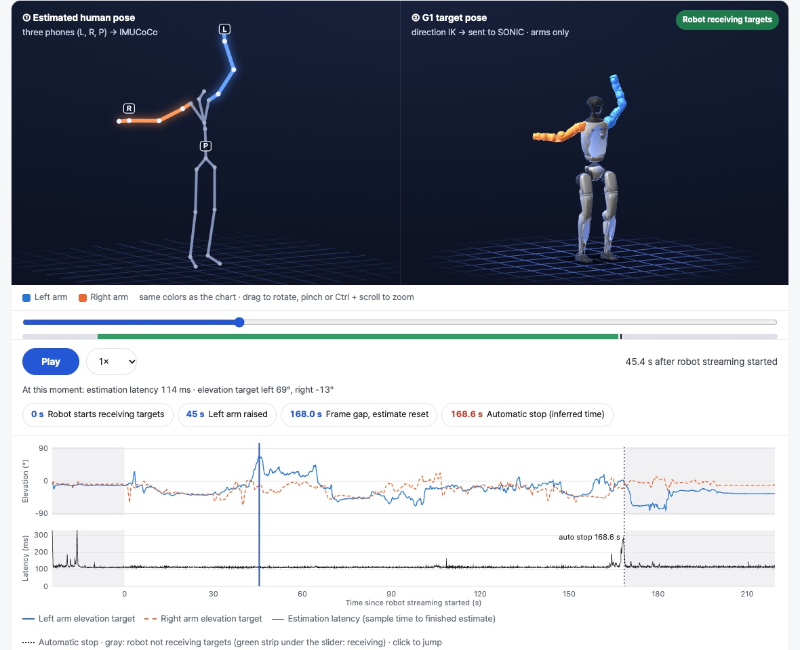
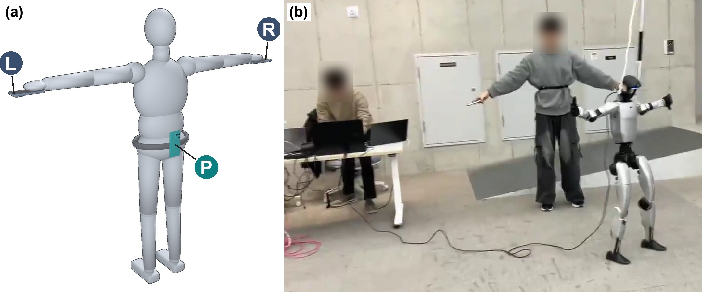
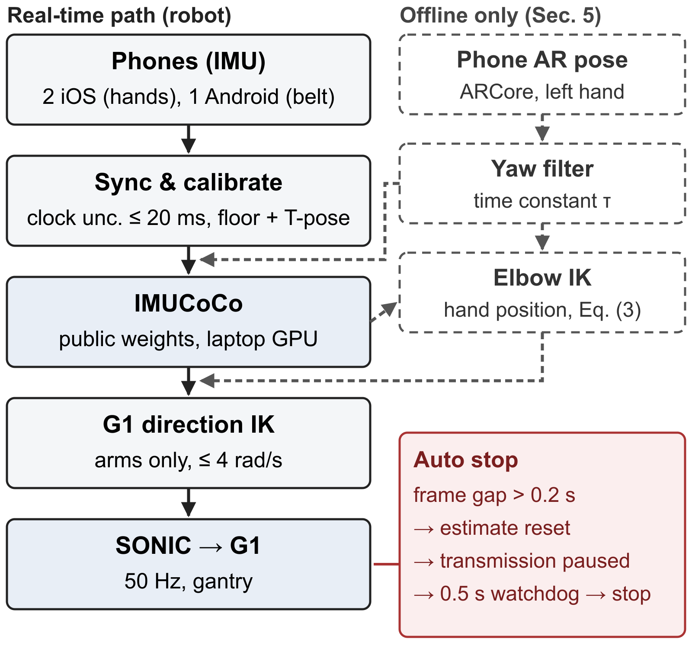
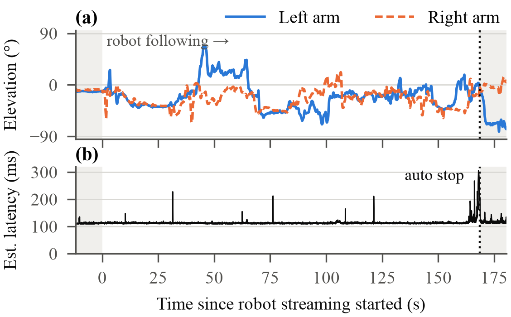

# Hand-Held Smartphone Teleoperation of a G1 Humanoid Upper Body

**English** · [한국어](README.ko.md)

Logs, figures and a browser replay for the KRoC 2027 paper *Hand-Held Smartphone Teleoperation of a G1 Humanoid Upper Body* (Sanghyun An, Jae Wook Kang, Sehwan Park; Seoul National University). Three ordinary smartphones, two in the hands and one on the belt, drove the upper body of a real Unitree G1 in real time.

- **Type:** robot experiment, undergraduate team research; this repository is the public companion to the paper
- **What is here:** sanitized logs of the two real-robot demonstrations, a web replay of the three-phone run, the paper's figures and a script that recomputes the paper's numbers from the logs
- **Stack:** phone IMU (iOS, Android), IMUCoCo pose estimation, direction IK for the 29-DoF G1, NVIDIA SONIC whole-body policy

**Try it in the browser: [sesepark.github.io/smartphone-g1-teleop](https://sesepark.github.io/smartphone-g1-teleop/)** · **Paper: [PDF](paper/KRoC2027_handheld_smartphone_G1_teleoperation.pdf)**



*Web replay of the last three-phone run on the real G1 (2026-11-22). Left: human pose estimated from the phones. Right: G1 target pose sent to SONIC. Bottom: arm elevation targets and estimation latency; the dotted line is the automatic stop. Both poses come from the estimation server's recording; neither is a measurement of the robot.*



*Paper Fig. 2. (a) Phone placement from behind: L and R are iOS phones in the hands, P is an Android phone on the belt. (b) The G1 on a gantry follows the operator. Faces blurred.*

## Overview

Humanoid teleoperation usually needs a VR headset or a motion-capture suit. The paper asks whether phones people already carry can do the job, and makes three contributions:

1. **A real-time pipeline from phone IMUs to a real G1.** Phone rotations and accelerations go through the public IMUCoCo model and a bone-direction IK into joint targets for NVIDIA's SONIC policy. With three phones it teleoperated the upper body of a gantry-supported G1.
2. **An automatic stop, checked on the robot.** When input stops, the estimate resets, transmission pauses and a 0.5 s watchdog stops the robot.
3. **Elbow from the phone's AR hand position (offline).** Hand-held IMUs leave the elbow undetermined. An analytic swivel IK uses the AR-tracked wrist position to fix the elbow flexion. It was evaluated only by replaying recorded one-arm data.



*Paper Fig. 1. Solid: the real-time path and automatic stop used on the G1. Dashed: the AR coupling, used in offline replay only.*

## Implementation

| Stage | What runs | Setting recorded with the run |
| --- | --- | --- |
| Phone input | Android game rotation vector and iOS `xArbitraryZVertical` attitude (no magnetometer); four-timestamp clock sync per phone | samples with clock error over 20 ms rejected, resampled to 60 Hz |
| Calibration | 8 s floor alignment, then an 8 s palms-down T-pose | `tpose_variant = palms_down` |
| Pose estimation | IMUCoCo with the authors' public weights, no retraining; phones placed at the hands and behind the pelvis | upstream commit `d7dd17c` |
| Retargeting | bone-direction IK, damped least squares, arm joints only, joint speed limit 4 rad/s | `g1_target_scope = arms` |
| SONIC | reference delayed 0.35 s and sent at 50 Hz over ZMQ to the official controller, wired DDS to the G1 | `delay_seconds = 0.35` |
| Stop | aligned-frame gap over 0.2 s resets the estimate and pauses transmission; 0.5 s without transmission triggers the watchdog | `max_gap_seconds = 0.2`, `watchdog_timeout_seconds = 0.5` |

Everything from phone reception to the SONIC controller ran on one GPU laptop. The settings column is read from the published `session.json`, `sonic-live.json` and controller files; `tools/check_paper_numbers.py` checks each one.

## Results

**Real robot (G1 on a gantry).**

| Demonstration | Phones | Result | Logs here |
| --- | --- | --- | --- |
| 1st, 2026-11-21 | one iOS phone, right hand | the G1's right arm followed the operator in three runs; when the phone app was closed, the robot stopped **0.976 s** after the last input | [`data/runs/20261121-215716-g1-supported-one-iphone`](data/runs/20261121-215716-g1-supported-one-iphone) |
| 2nd, 2026-11-22 | two iOS phones in the hands, one Android phone on the belt | seven runs; both arms followed on video. The last run lasted about 2 min 50 s. With the laptop's web window closed, the 10 s window at 2 min 38 s showed **60.0 frames/s** and **114 ms** p95 estimation latency. It ended when the frame interval exceeded 0.2 s and the watchdog stopped the robot | [`data/runs/20261122-174632-live-three-phone-dev`](data/runs/20261122-174632-live-three-phone-dev) |

The 60.0 frames/s and 114 ms are the values the Studio showed during the run. Recomputed afterwards from the same recording, the 16 ten-second windows of the robot window give 58.7–60.0 frames/s and a p95 latency of 113.4–118.3 ms. Estimation latency runs from the input sample time to the finished estimate and excludes SONIC's 0.35 s reference delay.



*Paper Fig. 3. (a) G1 arm elevation targets. (b) Estimation latency; dotted: automatic stop; gray: robot not following. `tools/fig3_run7_timeline.py` redraws it from the published logs; on 2026-11-25 the output was byte-identical to the paper's figure.*

**AR elbow, offline replay (preliminary).** Three one-arm development recordings (one Android phone in the left hand) were replayed through the same code with and without the AR hand position.

| Rec. | Condition | Elev. error (°) | Jerk p95, elbow / wrist (m/s³) |
| --- | --- | ---: | ---: |
| 1 | IMU-only | 25.85 | 517.7 / 903.1 |
| 1 | AR yaw | 25.88 | 520.8 / 905.6 |
| 1 | AR IK | 17.63 | 1617.9 / 3015.9 |
| 2 | IMU-only | 53.05 | 208.7 / 328.6 |
| 2 | AR IK | 56.01 | 255.3 / 431.5 |
| 2 (recomp.) | AR IK | 22.88 | 537.8 / 742.9 |
| 3 | IMU-only | 43.23 | 610.4 / 1028.5 |
| 3 | AR IK | 12.55 | 936.7 / 1461.8 |

The arm-elevation error fell in recordings 1 and 3. In recording 2 it rose with the AR input as recorded and fell once that input was recomputed at the same timestamps. Jerk p95 rose 1.3–3.3× at the wrist, above the 10% bound fixed in advance for a three-phone test. Source: [`data/one-arm-replay/metrics.csv`](data/one-arm-replay/metrics.csv).

## Getting started

**Watch the run.** Open the [web replay](https://sesepark.github.io/smartphone-g1-teleop/). It works on desktop and mobile browsers with WebGL. To serve it locally:

```sh
git clone https://github.com/sesepark/smartphone-g1-teleop
cd smartphone-g1-teleop
python3 -m http.server 8000 --directory docs   # then open http://127.0.0.1:8000
```

**Recompute the paper's numbers.** Python 3 standard library only, about 10 s.

```sh
python3 tools/check_paper_numbers.py          # 35 checks; exits non-zero if one fails
```

**Rebuild derived files.**

```sh
python3 tools/build_web_replay.py data/runs/20261122-174632-live-three-phone-dev docs/data
uv run --no-project --with numpy --with matplotlib python tools/fig3_run7_timeline.py   # or any Python with numpy + matplotlib
```

`tools/prepare_public_data.py` documents how the public logs were made from the team's raw archive; it needs that archive and is not meant to be rerun by others.

## Documents

| Document | Contents |
| --- | --- |
| [paper/](paper/README.md) | the submitted manuscript (PDF, Korean with an English abstract) |
| [EVIDENCE.md](EVIDENCE.md) | every number and setting in the paper, with its source file and check |
| [data/README.md](data/README.md) | file formats, the run list of 2026-11-22, what was cleaned |
| [data/one-arm-replay/README.md](data/one-arm-replay/README.md) | conditions and columns of Table 1 |
| [THIRD_PARTY.md](THIRD_PARTY.md) | G1 meshes, IMUCoCo, SONIC and their licenses |

## Scope and limits

- The robot runs used the IMU path only. The AR elbow method was evaluated offline on three development recordings from one person; it has not run on the robot. During the robot runs the phones' AR poses were received and logged but not used.
- Following accuracy on the robot was not measured: there is no ground-truth human pose, and the replay shows estimated poses and joint targets, not robot joint measurements.
- The robot goes limp when it stops, so a gantry is needed. Input gaps came from both wireless reception and laptop processing.
- Not included: videos with faces, the three one-arm source recordings behind Table 1, the magnetometer recording behind the 38.9° figure in Sec. 3.1, the static recording behind τ = 4.66 s, and the system code (phone apps, estimation server, SONIC bridge), which stays in the team's private repository.
- Phone identifiers, private IP addresses and laptop paths were replaced by placeholders. Measurements and timestamps are unchanged.

## Related projects

- [IMUCoCo](https://github.com/cmusmashlab/IMUCoCo): pose estimation from IMUs at arbitrary body positions; used with its public weights.
- [GR00T Whole-Body Control (SONIC)](https://github.com/NVlabs/GR00T-WholeBodyControl): the G1 whole-body tracking policy and controller used on the robot.
- [unitree_mujoco](https://github.com/unitreerobotics/unitree_mujoco): source of the G1 model and the meshes in the web replay.

## Citation

```bibtex
@inproceedings{an2027smartphone,
  title     = {Hand-Held Smartphone Teleoperation of a {G1} Humanoid Upper Body},
  author    = {An, Sanghyun and Kang, Jae Wook and Park, Sehwan},
  booktitle = {Korea Robotics Society Annual Conference (KRoC)},
  year      = {2027},
  note      = {Submitted}
}
```

## License

Code is GPL-3.0 ([LICENSE](LICENSE)). The recorded data in `data/` and `docs/data/` is CC BY 4.0. The paper and its figures remain © the authors, all rights reserved. The G1 meshes keep Unitree's BSD-3-Clause license. Details: [data/LICENSE.md](data/LICENSE.md).
